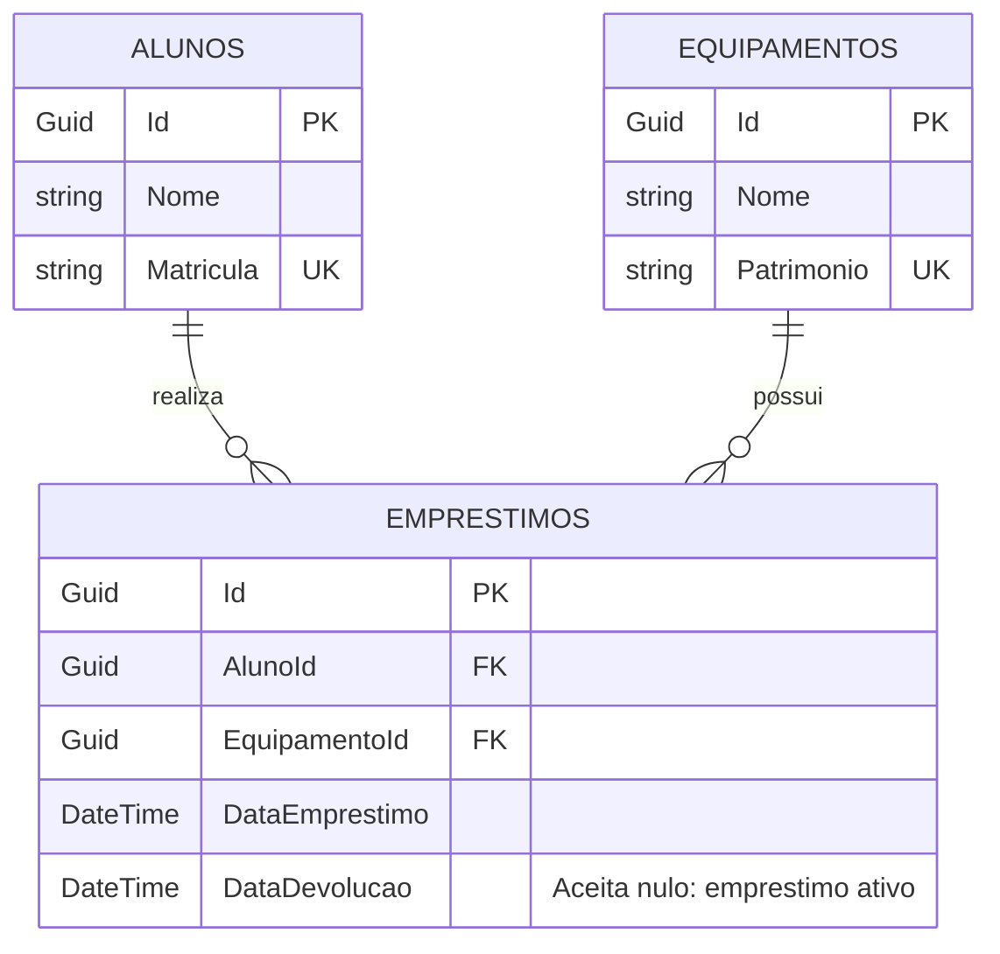

# LabTrack — Controle de Empréstimos de Equipamentos Acadêmicos

Sistema web — API REST em C# + interface em React — para controlar o empréstimo de equipamentos de laboratório (notebooks, projetores e outros) a estudantes: quem está com cada aparelho, desde quando, e quais equipamentos estão livres para emprestar.

---

## Link vídeo: https://www.youtube.com/watch?v=1O7b_TGwab0

## 1. Identificação

|                 |                                                                          |
|-----------------|--------------------------------------------------------------------------|
| **Projeto**     | LabTrack — Sistema de Controle de Empréstimos de Equipamentos Acadêmicos |
| **Integrantes** | Alysson José Gondim Souza · Lucas de Oliveira Imroth                     |
| **Curso**       | Ciência da Computação — Universidade Positivo                            |
| **Disciplina**  | Desenvolvimento de Software Visual                                       |
| **Turma**       | 2026/2                                                                   |

---

## 2. Resumo

Laboratórios acadêmicos emprestam notebooks, projetores e outros equipamentos a estudantes, mas o controle costuma ser manual (planilhas ou papel). Isso dificulta saber com quem está cada aparelho e permite que o mesmo equipamento seja "emprestado" duas vezes ao mesmo tempo. O **LabTrack** é um sistema web desenvolvido com uma API REST em C# (ASP.NET Core Minimal API), Entity Framework Core, SQLite e uma interface React. O sistema cadastra equipamentos e alunos, registra empréstimos e devoluções e consulta a disponibilidade atual dos equipamentos. As regras de negócio são garantidas em duas camadas — na API, com respostas HTTP claras, e no próprio banco de dados, com chaves estrangeiras e índices únicos, impedindo empréstimos simultâneos do mesmo equipamento, devoluções repetidas e a exclusão de equipamentos que possuem histórico de empréstimos. Uma interface web em React (TypeScript) consome a API e permite operar todo o fluxo pelo navegador, com estilo (CSS) gerado com auxílio de IA.

---

## 3. Principais funcionalidades

- **CRUD completo de equipamentos** (cadastrar, listar, buscar por id, alterar e excluir), com patrimônio único.
- **Cadastro, listagem e busca de alunos**, com matrícula única.
- **Registro de empréstimo**, vinculando um aluno e um equipamento previamente cadastrados.
- **Bloqueio de empréstimo duplicado**: um equipamento só pode ter um empréstimo ativo por vez.
- **Registro de devolução**, com bloqueio de devolução repetida.
- **Consulta de equipamentos disponíveis** (sem empréstimo ativo), calculada a partir dos empréstimos.
- **Preservação do histórico**: equipamentos com empréstimos registrados não podem ser excluídos.
- **Persistência em SQLite** com estrutura do banco versionada por migrations.
- **Interface web em React** com quatro abas (Equipamentos, Alunos, Empréstimos e Disponíveis), mostrando as mensagens de sucesso e de erro retornadas pela API.

---

## 4. Descrição detalhada das funcionalidades

### 4.1 Equipamentos — CRUD completo

| Método   | Rota                     | Descrição                                       | Respostas          |
|----------|--------------------------|-------------------------------------------------|--------------------|
| `GET`    | `/api/equipamentos`      | Lista todos os equipamentos em ordem alfabética | 200                |
| `GET`    | `/api/equipamentos/{id}` | Busca um equipamento pelo id                    | 200, 404           |
| `POST`   | `/api/equipamentos`      | Cadastra um equipamento                         | 201, 400, 409      |
| `PUT`    | `/api/equipamentos/{id}` | Altera nome e patrimônio                        | 200, 400, 404, 409 |
| `DELETE` | `/api/equipamentos/{id}` | Exclui um equipamento                           | 204, 404, 409      |

Corpo de `POST` e `PUT`:
```json
{ "nome": "Notebook Dell", "patrimonio": "LAB001" }
```

Regras:
- **Nome** (até 100 caracteres) e **patrimônio** (até 50) são obrigatórios → `400` se ausentes, vazios ou longos demais.
- O patrimônio é **normalizado** pela remoção de todos os caracteres de espaço em branco, inclusive internos, e pela conversão para letras maiúsculas. Por exemplo, `" lab 001 "` é gravado como `"LAB001"`. A normalização é aplicada no cadastro (`POST`) e na alteração (`PUT`).
- O patrimônio é **único** → `409 Conflict` se já pertencer a outro equipamento. A regra é verificada pela API e garantida por um índice único no banco.
- No `PUT`, o equipamento pode manter o próprio patrimônio; só há conflito se ele pertencer a **outro** equipamento.
- No `DELETE`, existem três situações:
  - Equipamento sem histórico de empréstimos: exclusão permitida (`204`).
  - Equipamento com empréstimo ativo: exclusão bloqueada (`409`), com mensagem informando que o equipamento está emprestado.
  - Equipamento com empréstimos anteriores já devolvidos: exclusão bloqueada (`409`), com mensagem informando a existência de histórico.
- A restrição de exclusão preserva o histórico de empréstimos e é reforçada pelo banco com `ON DELETE RESTRICT`.
- O id é um GUID gerado pelo servidor; ids em formato inválido na URL (ex.: `/api/equipamentos/abc`) retornam `404`.

### 4.2 Alunos

| Método | Rota               | Descrição                                 | Respostas     |
|--------|--------------------|-------------------------------------------|---------------|
| `GET`  | `/api/alunos`      | Lista todos os alunos em ordem alfabética | 200           |
| `GET`  | `/api/alunos/{id}` | Busca um aluno pelo id                    | 200, 404      |
| `POST` | `/api/alunos`      | Cadastra um aluno                         | 201, 400, 409 |

Corpo do `POST`:
```json
{ "nome": "João Silva", "matricula": "2026001" }
```

Regras:
- **Nome** (até 100 caracteres) e **matrícula** (até 20) são obrigatórios → `400`.
- A matrícula é **única** → `409` (verificada pela API e garantida por índice único no banco). Dois alunos podem ter o mesmo nome.

### 4.3 Empréstimos

| Método | Rota                    | Descrição                                                | Respostas          |
|--------|-------------------------|----------------------------------------------------------|--------------------|
| `GET`  | `/api/emprestimos`      | Lista os empréstimos, do mais recente para o mais antigo | 200                |
| `GET`  | `/api/emprestimos/{id}` | Busca um empréstimo pelo id                              | 200, 404           |
| `POST` | `/api/emprestimos`      | Registra um empréstimo                                   | 201, 400, 404, 409 |

Corpo do `POST`:
```json
{ "alunoId": "<id do aluno>", "equipamentoId": "<id do equipamento>" }
```

Regras:
- `alunoId` e `equipamentoId` são obrigatórios → `400`.
- O aluno e o equipamento precisam **existir** → `404` com mensagem indicando qual não foi encontrado.
- **Um equipamento só pode ter um empréstimo ativo** (sem data de devolução) → `409`. A regra é verificada pela API e garantida no banco por um **índice único filtrado** (`EquipamentoId` único entre as linhas em que `DataDevolucao IS NULL`). Mesmo em requisições simultâneas, a violação desse índice é capturada e convertida em `409`.
- A data do empréstimo é definida pelo **servidor** (UTC); o cliente não informa datas.

### 4.4 Devolução

| Método  | Rota                              | Descrição                             | Respostas     |
|---------|-----------------------------------|---------------------------------------|---------------|
| `PATCH` | `/api/emprestimos/{id}/devolucao` | Registra a devolução de um empréstimo | 200, 404, 409 |

Regras:
- Preenche a `DataDevolucao` com a data/hora do servidor (UTC). Não há corpo na requisição.
- Um empréstimo já devolvido **não pode ser devolvido novamente** → `409`.
- Após a devolução, o equipamento volta automaticamente a ficar disponível para um novo empréstimo.

### 4.5 Equipamentos disponíveis

| Método | Rota                            | Descrição                                  | Respostas |
|--------|---------------------------------|--------------------------------------------|-----------|
| `GET`  | `/api/equipamentos/disponiveis` | Lista os equipamentos sem empréstimo ativo | 200       |

A disponibilidade **não é uma coluna** no banco: ela é **calculada** a partir dos empréstimos (equipamentos para os quais não existe empréstimo com `DataDevolucao` nula), o que evita inconsistências entre um "status" gravado e a situação real.

### 4.6 Verificação da API

| Método | Rota | Descrição                                | Respostas |
|--------|------|------------------------------------------|-----------|
| `GET`  | `/`  | Confirma que a API está em funcionamento | 200       |

### 4.7 Interface web (front-end React)

Aplicação React com TypeScript (Create React App) em `front/`, que consome a API em `http://localhost:5016/api`. É uma única página com quatro abas:

| Aba              | O que permite fazer                                                                                                                                   | Endpoints usados                                                     |
|------------------|-------------------------------------------------------------------------------------------------------------------------------------------------------|----------------------------------------------------------------------|
| **Equipamentos** | Cadastrar, listar, editar (o formulário passa para o modo "Salvar alteração") e excluir com confirmação                                               | `GET`, `POST`, `PUT`, `DELETE /api/equipamentos`                     |
| **Alunos**       | Cadastrar e listar alunos                                                                                                                             | `GET`, `POST /api/alunos`                                            |
| **Empréstimos**  | Registrar empréstimo escolhendo o aluno e um equipamento **disponível** em listas; listar com nome, matrícula, patrimônio, datas e situação; devolver | `GET`, `POST /api/emprestimos`, `PATCH .../devolucao`, `GET .../disponiveis` |
| **Disponíveis**  | Consultar os equipamentos livres para empréstimo                                                                                                      | `GET /api/equipamentos/disponiveis`                                  |

- As mensagens da API (campo `mensagem`) aparecem em uma faixa verde (sucesso) ou vermelha (erro), por exemplo no `409` de patrimônio duplicado ou de equipamento já emprestado.
- As datas, gravadas em UTC pela API, são exibidas no horário local do navegador.

### Padrão de respostas de erro

Todas as respostas de erro retornam um objeto JSON com a chave `mensagem`:
```json
{ "mensagem": "Este equipamento já está emprestado." }
```

---

## 5. Modelo de dados



PK = chave primária; FK = chave estrangeira; UK = campo único.

- **Equipamento** e **Aluno** podem aparecer em vários empréstimos ao longo do tempo (relacionamento um-para-muitos).
- As chaves estrangeiras usam `ON DELETE RESTRICT`: o banco recusa excluir alunos ou equipamentos que possuem empréstimos.
- Índice único filtrado em `Emprestimos(EquipamentoId) WHERE DataDevolucao IS NULL`: no máximo um empréstimo ativo por equipamento.

---

## 6. Tecnologias

- **C# / .NET 10** — ASP.NET Core **Minimal API**, com **CORS** liberado para o front-end
- **Entity Framework Core 10** (ORM) com **migrations**
- **SQLite** (banco de dados em arquivo)
- **React 19 (React Vanilla) + TypeScript** (Create React App) — componentes próprios, React Hooks, Fetch API e CSS puro, sem frameworks adicionais de aplicação ou bibliotecas de componentes visuais
- **CSS** gerado com auxílio de IA (ver seção 12)
- **Git / GitHub** (versionamento e colaboração)
- **Postman** (testes das requisições HTTP)
- **VS Code** com C# Dev Kit

---

## 7. Como executar

### Pré-requisitos
- [.NET SDK 10](https://dotnet.microsoft.com/download)
- [Node.js](https://nodejs.org/) (com npm)
- Git

### Passo a passo
```bash
# 1. Clonar o repositório
git clone https://github.com/alysouza84/LabTrack.git
cd LabTrack

# 2. Restaurar a ferramenta de migrations (dotnet-ef, versão fixada em dotnet-tools.json)
dotnet tool restore

# 3. Entrar no projeto da API e criar o banco a partir das migrations
cd LabTrack.Api
dotnet ef database update

# 4. Executar a API
dotnet run
```

A API fica disponível em **http://localhost:5016**.

### Front-end (em um segundo terminal, com a API rodando)
```bash
# a partir da raiz do repositório
cd front
npm install    # baixa as dependências (só na primeira vez ou após mudanças no package.json)
npm start      # abre http://localhost:3000 no navegador
```

Caso ocorra um conflito de dependências (`ERESOLVE`) durante a instalação, execute:

```bash
npm install --legacy-peer-deps
npm start
```

> A API só aceita chamadas do navegador vindas de `http://localhost:3000` (política de CORS `FrontLocal`).

> Os comandos de banco e de execução devem ser rodados **dentro da pasta `LabTrack.Api`**, pois o arquivo `labtrack.db` é criado na pasta atual. O banco não é versionado: cada desenvolvedor gera o seu a partir das migrations.

### Exemplo de uso (fluxo completo)
1. `POST /api/alunos` → `{ "nome": "João Silva", "matricula": "2026001" }`
2. `POST /api/equipamentos` → `{ "nome": "Notebook Dell", "patrimonio": "LAB001" }`
3. `POST /api/emprestimos` com os ids retornados → **201** (empréstimo ativo)
4. Repetir o passo 3 → **409**: o equipamento já está emprestado
5. `GET /api/equipamentos/disponiveis` → LAB001 **não aparece**
6. `PATCH /api/emprestimos/{id}/devolucao` → **200** (devolução registrada)
7. `GET /api/equipamentos/disponiveis` → LAB001 **volta a aparecer**

---

## 8. Estrutura do repositório

```
LabTrack/
├── LabTrack.slnx                 # Solução
├── dotnet-tools.json             # Versão fixa do dotnet-ef
├── .gitignore
├── .gitattributes
├── README.md
├── LabTrack.Api/
│   ├── LabTrack.Api.csproj
│   ├── Program.cs                # Configuração e endpoints
│   ├── appsettings.json          # Connection string do SQLite
│   ├── Models/                   # Entidades
│   ├── Requests/                 # DTOs de entrada
│   ├── Data/                     # DbContext e regras do banco
│   └── Migrations/               # Histórico de alterações do banco
├── docs/
│   └── LabTrack.postman_collection.json
└── front/
    ├── package.json
    ├── public/
    ├── tsconfig.json
    └── src/
        ├── index.tsx
        ├── App.tsx               # Navegação por abas
        ├── App.css               # Estilo gerado com auxílio de IA
        ├── config.ts             # Endereço da API
        ├── utils.ts              # Datas e mensagens de erro
        ├── models/
        │   ├── Aluno.ts
        │   ├── Equipamento.ts
        │   └── Emprestimo.ts
        └── components/
            ├── Alunos.tsx
            ├── Disponiveis.tsx
            ├── Emprestimos.tsx
            ├── Equipamentos.tsx
            └── Mensagem.tsx
```

---

## 9. Decisões técnicas

- **Regras em duas camadas**: a API valida e responde com mensagens claras (`400`, `404`, `409`); o banco garante as mesmas regras com índices únicos, índice filtrado e chaves estrangeiras.
- **DTOs (`records`) na entrada**: o cliente envia apenas os campos permitidos; ids e datas são sempre gerados pelo servidor.
- **Rotas REST**: recursos no plural e operação definida pelo método HTTP; a devolução é uma operação de negócio exposta como `PATCH .../devolucao`.
- **Empréstimo como registro histórico**: não há edição ou exclusão genérica de empréstimos; a única alteração permitida é a devolução.
- **Datas em UTC**, definidas pelo servidor.
- **Consultas de leitura com `AsNoTracking`** e acesso assíncrono (`async/await`) ao banco.
- **Propriedades de navegação** (`Emprestimo.Aluno`, `Emprestimo.Equipamento` e as coleções `Emprestimos`) para modelar o relacionamento; as coleções ficam fora do JSON (`[JsonIgnore]`) para evitar ciclos.
- **CORS restrito** à origem do front-end (`http://localhost:3000`), em vez de liberar qualquer origem.
- **Front-end sem bibliotecas extras**: navegação por abas com `useState`, requisições com `fetch` e estilo em CSS puro.

---

## 10. Colaboração e versionamento

O desenvolvimento foi dividido em etapas sequenciais e alternadas entre os integrantes, cada uma testada antes da seguinte:

| Etapa | Responsável | Entrega                                                                                  |
|-------|-------------|------------------------------------------------------------------------------------------|
| 1     | Alysson     | Estrutura da solução, EF Core + SQLite, entidade Equipamento, cadastro/listagem/busca    |
| 2     | Lucas       | Alteração (PUT) e exclusão (DELETE) de equipamentos — Pull Request #1                    |
| 3     | Alysson     | Entidade Aluno, migration e endpoints                                                    |
| 4     | Lucas       | Entidade Emprestimo, relacionamentos, bloqueio de empréstimo duplicado — Pull Request #2 |
| —     | Alysson     | Correção identificada na revisão: exclusão restrita de equipamentos com histórico        |
| 5     | Alysson     | Registro de devolução                                                                    |
| 6     | Lucas       | Consulta de equipamentos disponíveis — Pull Request #3                                   |
| 7     | Lucas       | Refatoração: propriedades de navegação no relacionamento de Empréstimo                   |
| 8     | Alysson     | CORS na API, projeto React, modelos, abas, CSS e tela de Equipamentos                    |
| 9     | Lucas       | Telas de Alunos, Empréstimos e Disponíveis, testes gerais e atualização do README        |
| 10    | Lucas       | Correções finais na normalização dos patrimônios, diferenciação das mensagens de exclusão e revisão dos requisitos |

Os commits seguem o padrão *Conventional Commits* (`feat:`, `fix:`, `chore:` e `docs:`), utilizando branches específicas para as etapas de desenvolvimento e Pull Requests para integração das funcionalidades à branch principal.

---

## 11. Limitações e trabalhos futuros

- Não há autenticação/autorização (ex.: JWT com perfis "laboratorista" e "aluno"); a API é destinada ao uso pelo responsável do laboratório.
- A navegação do front-end é feita por abas (estado `useState`), sem rotas próprias: a URL não muda e atualizar a página volta para a primeira aba.
- As listagens não têm paginação nem filtros de busca.
- Possíveis evoluções: histórico de empréstimos por aluno, prazo de devolução e alertas de atraso, empacotamento em container (Docker) e publicação em nuvem.

---

## 12. Uso de IA

**Ferramentas utilizadas**
- **Claude (Anthropic)** — utilizado como tutor durante todo o desenvolvimento.
- **ChatGPT (OpenAI)** — utilizado como tutor, auxiliando na compreensão do código e no versionamento com Git.

**Como foi utilizada**
- A IA foi instruída a atuar como professor: explicar linha por linha cada comando, classe, método e decisão técnica, em etapas pequenas, sem avançar antes da confirmação de compilação e testes.
- Para cada etapa, a IA forneceu o roteiro (comandos, código, conceitos e tabela de testes com resultados esperados). Cada integrante **implementou, integrou, revisou e testou** o código da sua etapa na própria máquina (Alysson em macOS, Lucas em Windows) e fez os commits com sua própria conta.

- A IA também revisou o código do repositório entre as etapas e redigiu, com revisão da equipe, este README (resumo, lista e descrição das funcionalidades).
- **Front-end e estilo:** a IA gerou a folha de estilos `front/src/App.css` (paleta, abas, cartões, formulários, tabelas, selos de situação e layout para celular), conforme exigido no enunciado, e propôs a estrutura das telas em React. A equipe integrou os arquivos, executou a aplicação contra a API e realizou testes funcionais pelo navegador.

**Revisões e ajustes feitos pela equipe**
- Adaptações próprias no código: padronização das mensagens de erro com a chave `mensagem`, tamanho do patrimônio (50 caracteres), ordem das validações no PUT e tratamento da violação do índice único do SQLite (erro 2067) no cadastro de empréstimos, que foi além da proposta inicial.

- Erros encontrados e corrigidos durante os testes: namespace com maiúsculas incorretas (`Labtrack` × `LabTrack`), rota testada no plural em vez do singular e quebras de linha CRLF geradas pelos templates (padronizadas com `.gitattributes`).

- Na revisão da Etapa 4, foi identificado que a exclusão em cascata (`Cascade`) apagaria o histórico de empréstimos; a equipe corrigiu para `Restrict` com nova migration e verificação `409` no endpoint.

- A sugestão inicial de usar .NET 8 foi revisada pela equipe, que optou pelo .NET 10 com pacotes do EF Core alinhados na mesma versão.

- Aprimoramento da normalização dos patrimônios, removendo espaços internos e externos para evitar duplicidades decorrentes de diferenças de formatação.
- Diferenciação das mensagens de erro na exclusão de equipamentos, distinguindo empréstimos ativos de históricos de empréstimos.
- Revisão das funcionalidades e da integração entre a interface React e a API REST.

---

## 13. Testes e validações

Os cenários abaixo servem como roteiro de validação funcional pela interface web e por requisições HTTP no Postman, verificando as operações da API e as regras de negócio. A tabela apresenta os resultados esperados.

| Cenário de teste | Resultado esperado |
|------------------|--------------------|
| Cadastro de equipamento válido | `201` — Cadastrado |
| Cadastro de patrimônio duplicado | `409` — Conflito |
| Normalização de patrimônio com espaços internos | Patrimônio normalizado |
| Alteração de equipamento | `200` — Atualizado |
| Exclusão de equipamento sem histórico | `204` — Excluído |
| Exclusão de equipamento emprestado | `409` — Empréstimo ativo |
| Exclusão de equipamento com histórico | `409` — Histórico preservado |
| Cadastro de aluno | `201` — Cadastrado |
| Cadastro de matrícula duplicada | `409` — Conflito |
| Registro de empréstimo | `201` — Registrado |
| Empréstimo duplicado de equipamento | `409` — Conflito |
| Consulta de disponíveis durante empréstimo | Equipamento não listado |
| Registro de devolução | `200` — Devolvido |
| Devolução repetida | `409` — Conflito |
| Consulta de disponíveis após devolução | Equipamento listado |
| Persistência após atualização da página | Dados preservados |
| Navegação entre as abas | Funcionamento correto |

---

## 14. Atendimento aos requisitos acadêmicos

| Requisito | Implementação no LabTrack |
|-----------|--------------------------|
| Tema livre, exceto vendas e e-commerce | Controle de empréstimos de equipamentos acadêmicos |
| Compartilhamento e colaboração de código | Git e GitHub, com branches, commits e Pull Requests |
| 2 a 4 entidades | Três entidades: Equipamento, Aluno e Emprestimo |
| CRUD completo em pelo menos uma entidade | Equipamentos |
| Relacionamento entre entidades | Empréstimo vinculado a aluno e equipamento previamente cadastrados |
| Funcionalidades além de cadastros | Empréstimos, devoluções e consulta de disponibilidade |
| C# com Minimal API | ASP.NET Core com .NET 10, versão adotada pela equipe |
| React Vanilla | React com TypeScript e componentes próprios |
| Estilização com auxílio de IA | CSS puro gerado com auxílio de IA |
| Entity Framework | Entity Framework Core 10 |
| SQLite | Banco de dados persistente em arquivo |

---

## 15. Conclusão

O LabTrack foi desenvolvido para atender à necessidade de controle de empréstimos de equipamentos em ambientes acadêmicos, oferecendo uma interface web integrada a uma API REST e a um banco de dados relacional.

O projeto aplica conceitos de desenvolvimento full-stack, modelagem de dados, operações CRUD, relacionamentos entre entidades, validação de regras de negócio, comunicação HTTP e versionamento colaborativo.

A solução permite controlar o ciclo completo de empréstimo e devolução de equipamentos, preservando a integridade dos dados e o histórico de empréstimos e permitindo a consulta de disponibilidade.

O desenvolvimento em etapas possibilitou a aplicação prática dos conceitos estudados na disciplina de Desenvolvimento de Software Visual, com participação dos integrantes na implementação, integração e validação das funcionalidades.
